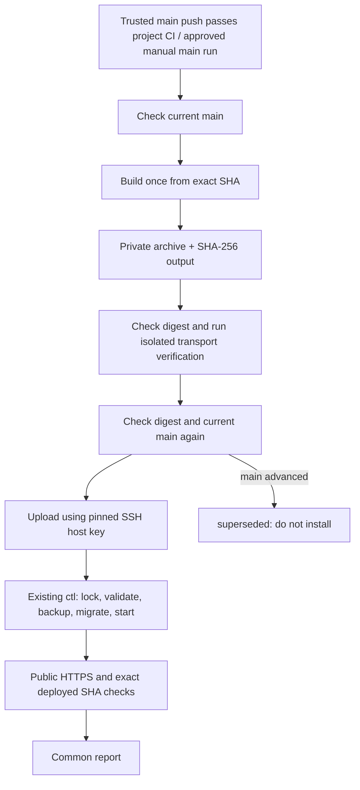

# Shared EC2 deployment

`deploy.py` is the canonical, standard-library delivery driver for MP and SSO.
Both projects vendor identical copies of it, `upload.sh` and
`tests/test_shared_deploy.py`. `project.json` selects the project adapter.
The `.github` repository stores profiles rather than an active project profile;
it cannot accidentally deploy either application. Python 3.12+ Linux runners
are the supported execution environment; Windows runs the local unit tests.

## Delivery path



SSO additionally keeps its early healthy-backend/frontend identity preflight:
`already_deployed` skips build, verify and upload, then runs public checks.
Its server-side no-op remains protected by ctl's lock. MP's existing forced
command reports installation through its exit status and always follows its
normal installation path; this change does not invent a server no-op for MP.

## What was combined

| Concern | Shared behavior |
| --- | --- |
| Immutable delivery (MP) | Build SHA-256 is passed independently through job outputs; verify and upload reject a different archive before using it |
| Transport limits (MP) | Regular non-symlink file, nonempty, at most 3 GiB; hash and upload use the same open file |
| Results (SSO) | Structured deployed/already_deployed/legacy handling, superseded main check, common final report |
| Credentials | Dedicated user, pinned known_hosts, identities-only SSH, private temporary files removed on exit, credentials removed from child environments |
| Time limits | GitHub lookup 30s, connect 15s, SSH keepalive, each upload/install subprocess at most 25 minutes, existing workflow limits retained |
| Public evidence | Project checks retained; SSO additionally requires the exact healthy backend and frontend SHA after installation |
| Failure | Nonzero exit on failed digest/protocol/command/public check; no raw private server output in CI |

Project differences are deliberate adapters, not duplicate deployment logic:

| | MP | SSO |
| --- | --- | --- |
| Runner | Existing self-hosted Linux | Existing hosted Ubuntu |
| Private storage | Runner artifact store | GitHub Artifacts |
| SSH delivery | stdin to forced `deploy SHA sequence` command | scp to this run's inbox, existing restricted sudo ssoctl command |
| Build/verify hooks | Existing MP bundle/security/runtime checks | Existing SSO bundle/runtime checks |
| Manual CI gate | Quality required unless explicit owner exception | Existing owner-approved manual main mode |

The workflows retain event gates, exact checkout, runner setup, artifact
retention and job dependencies. The shared driver owns the executable phases:

```bash
python3 deploy/ec2/deploy.py build
python3 deploy/ec2/deploy.py verify
bash deploy/ec2/upload.sh
python3 deploy/ec2/deploy.py public-check
python3 deploy/ec2/deploy.py report
```

These are CI phase commands, not a shortcut around verification. Build/verify
and public checks invoke the project commands from the committed profile.
`build` outputs `sha256`; consumers must set `BUNDLE_SHA256` from the **build job
output**, never recompute the expected value from a downloaded archive.

All application phases require `GITHUB_REPOSITORY` matching the profile and
`DEPLOY_SHA` (full lowercase SHA). Upload additionally requires
`DEPLOY_SEQUENCE`, `BUNDLE_SHA256`, `GH_TOKEN` with read access for the main-ref
lookup, `SSH_HOST`, `SSH_PRIVATE_KEY`, `SSH_KNOWN_HOSTS`, `GITHUB_OUTPUT`, and for
SSO `GITHUB_RUN_ID`/`GITHUB_RUN_ATTEMPT`. `SSH_PORT` defaults to 22. `SSH_USER`, if
set, must match the fixed profile user. Secrets belong only in the protected
production job. A successful upload writes `result`, `installed`,
`installed_sha`, `reason`, and `legacy` outputs. The final report requires public
success and matching installed SHA before reporting deployment success;
cancelled stages are errors. `deployed_legacy` remains visible for older SSO
operators without the machine protocol.

## Updating the shared delivery

Edit the canonical files here, run the tests, then copy to explicit checkouts:

```bash
python deploy/ec2/sync.py mp /path/to/mp-ryazanskiy
python deploy/ec2/sync.py sso /path/to/sso
python deploy/ec2/sync.py mp /path/to/mp-ryazanskiy --check
python deploy/ec2/sync.py sso /path/to/sso --check
python -m unittest discover -s tests -p test_shared_deploy.py -v
bash -n deploy/ec2/upload.sh
```

`sync.py` copies only the driver, wrapper, selected profile and shared tests;
`shared-deploy.json` records their SHA-256 hashes. Review and deliver each
repository's changes together. No runtime fetch of `.github/main` is allowed:
an existing project commit must remain reproducible when upstream changes.
The sync helper does not alter workflow adapters or project-specific helpers.

## Architecture decision and rollout limits

Keep the privileged server operators in `alxprgstech/ctl`. Do not edit generated
vendor operators or add application deployment to `self-update`. A single
monolithic build script would mix different images, migrations, runtime harnesses
and storage policies. A cross-repository workflow fetched from mutable main
would also require coordinated upstream publication and change the existing
runner/security contracts. Vendoring one executable driver with small profiles
keeps those contracts and makes the shared code independently reviewable.

Existing bootstrap, forced commands, sudoers, backup/migration/rollback and
maintenance rules remain authoritative. This adoption needs no new server
permissions and installs no root-owned operator. Real GitHub job scheduling,
Linux scp/SSH and production installation require subsequent deployment
validation; mocked process tests do not prove them. A failed SSH connection may
leave an uncertain server state: inspect ctl status and public identity before
retrying. There is no blind install retry, automatic database downgrade or
automatic restore.
